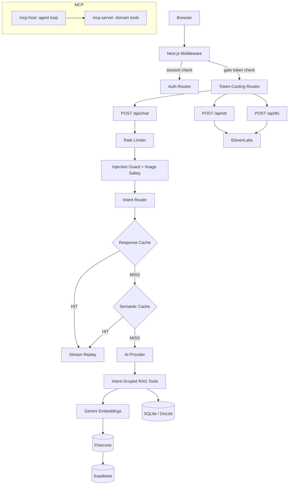

# FlavorJet

A full-stack food ordering system with a conversational AI assistant that handles menu discovery, dietary filtering, cart management, and order placement through natural language — text, voice, or image input. The engineering emphasis is on production-grade AI infrastructure: a multi-provider model abstraction, RAG-powered semantic menu retrieval via Pinecone, intent-based tool routing that minimizes per-request token spend, two-tier response caching, and a cost-protection gate for the live demo — not a thin wrapper around a single LLM call.

<!-- > **Live demo:** [flavorjet.vercel.app](https://flavorjet.vercel.app) — request an access code at gokulan90800@gmail.com to unlock the AI features. -->

---

## Contents

- [Features](#features)
- [Highlights](#highlights)
- [Architecture](#architecture)
- [Tech Stack](#tech-stack)
- [Quick Start](#quick-start)
- [Local Setup](#local-setup)
- [Access Gate](#access-gate)
- [Trade-offs](#trade-offs)
- [Testing](#testing)
- [Project Structure](#project-structure)

---

## Features

- Order food by chatting naturally ("something spicy under $15") — no menu-clicking required
- Voice ordering — speak your order, hear spoken responses back
- Snap a photo of a dish and ask "do you have this?" — image-based menu matching
- Cart stays in sync mid-conversation; edits, swaps, and removals all work through chat
- Dietary filtering (vegan, gluten-free, etc.) understood from natural phrasing
- Weather-aware recommendations — suggests soup on a cold day, cold drinks when it's hot
- Browse the full menu, customize items with modifiers, and check out — all without the AI if you prefer

---

## Quick Start

```bash
git clone <repo-url> && cd flavorjet-v2
npm install
cp .env.example .env.local   # fill in at minimum one AI provider key + Supabase + Pinecone
npm run dev                  # http://localhost:3000
```

See [Local Setup](#local-setup) for full environment variable reference and database initialization.

---

## Highlights

- **Multi-provider AI with intent routing** — A model registry abstracts across Anthropic Claude Haiku 4.5, Google Gemini 2.5 Flash Lite, and OpenAI GPT-4o Mini behind a single `getModel()` call, switchable via environment variable. A regex-based intent router classifies each message into one of 10 intent types and dispatches only the relevant tool subset to the model, reducing schema tokens per turn. Pure chitchat is handled locally with zero API calls.

- **RAG pipeline (Pinecone + Supabase enrichment)** — User queries are embedded with `gemini-embedding-001` (768-dimensional), matched against a Pinecone vector index of menu items, then enriched with live price/availability data from Supabase. Both the embedding layer and the Pinecone query layer maintain independent in-memory caches with TTL eviction to avoid redundant external calls on repeated queries.

- **Two-tier response caching** — An exact-match response cache replays full streamed byte sequences for identical stateless queries (zero model invocations on hit). A semantic input cache deduplicates at the normalized-query level. Both are TTL-gated and scoped exclusively to stateless intents (browse, search, info) — cart, reorder, and image intents are never cached.

- **Voice pipeline (ElevenLabs, server-proxied)** — STT (Scribe v1) and TTS (Turbo v2.5) proxied through Next.js API routes so the ElevenLabs API key never reaches the client. The system prompt adapts for voice mode (capped response length, no markdown formatting).

- **Interview access gate** — A signed, time-boxed cookie system (HMAC-SHA256, timing-safe comparison) backed by Upstash Redis stores a rotating access code and issues expiring tokens. The Next.js middleware verifies this token before proxying requests to the token-costing routes (`/api/chat`, `/api/stt`, `/api/tts`). This protects the live deployed demo from unbounded API spend while remaining transparent to interviewers given a code.

- **MCP packages** — A standalone MCP server (`@flavorjet/mcp-server`) exposes the ordering domain (auth, menu browse, cart, orders) over stdio with tools, resources, and elicitation support. A separate MCP host (`@flavorjet/mcp-host`) implements a multi-server agent loop with streaming, elicitation handling, and sampling delegation to Claude — both built on `@modelcontextprotocol/sdk` 1.20.

---

## Architecture



| Layer         | Responsibility                                                                                                        |
| ------------- | --------------------------------------------------------------------------------------------------------------------- |
| Middleware    | Session auth (Lucia), access-gate HMAC verification, route protection                                                 |
| API routes    | Zod request validation, sliding-window rate limiting, off-topic/injection regex guard, image MIME + URL scheme checks |
| Intent router | Classifies user message into 10 types, selects minimal tool subset for the model call                                 |
| Cache         | Exact-match response replay (FIFO-50, 5-min TTL) + semantic input dedup (FIFO-50, 5-min TTL)                          |
| AI provider   | Vercel AI SDK `streamText` with multi-step tool execution, message history compression                                |
| RAG           | Embed → Pinecone vector search → Supabase enrichment, with category detection and price filtering                     |
| Data          | SQLite (Drizzle ORM) for users, sessions, cart, orders; Supabase for menu catalog and restaurant metadata             |
| Voice         | Server-proxied ElevenLabs STT/TTS with timeout + error mapping                                                        |

---

## Tech Stack

| Category           | Technologies                                                                                                           |
| ------------------ | ---------------------------------------------------------------------------------------------------------------------- |
| **Frontend**       | Next.js 16.1.6 (App Router, Turbopack), React 19.2.3, TypeScript 5, Tailwind CSS 4, Framer Motion                      |
| **AI and RAG**     | Vercel AI SDK 6, `@ai-sdk/google` + `@ai-sdk/anthropic` + `@ai-sdk/openai`, `@google/genai` (embeddings), Pinecone 7.1 |
| **Voice**          | ElevenLabs Scribe v1 (STT), Turbo v2.5 (TTS), server-side proxied                                                      |
| **Auth and Data**  | Lucia 3 (session auth), SQLite via better-sqlite3 + Drizzle ORM 0.45, Supabase (menu/restaurant catalog)               |
| **Infrastructure** | Upstash Redis (access-gate code store), Cloudinary (image hosting), Zod (request validation)                           |
| **MCP**            | `@modelcontextprotocol/sdk` 1.20, stdio transport, elicitation + sampling support                                      |
| **Testing**        | Vitest 4.1 + Testing Library + happy-dom (unit/component), Playwright 1.60 (e2e)                                       |

---

## Local Setup

```bash
git clone <repo-url> && cd flavorjet-v2
npm install
```

### Required Environment Variables

Create `.env.local` at the project root. The app degrades gracefully — omitted optional vars disable the corresponding feature, they do not crash the server.

| Variable                        | Gates                                                                    |
| ------------------------------- | ------------------------------------------------------------------------ |
| `AI_PROVIDER`                   | Model selection (`google` / `openai` / `anthropic`, default: `google`)   |
| `GOOGLE_GENERATIVE_AI_API_KEY`  | Chat completions + embeddings (required if provider is `google`)         |
| `OPENAI_API_KEY`                | Chat (required if provider is `openai`)                                  |
| `ANTHROPIC_API_KEY`             | Chat (required if provider is `anthropic`)                               |
| `PINECONE_API_KEY`              | RAG vector search                                                        |
| `PINECONE_INDEX_NAME`           | RAG index name                                                           |
| `NEXT_PUBLIC_SUPABASE_URL`      | Menu data (client) — bare project URL, e.g. `https://xxx.supabase.co`, **no** `/rest/v1/` suffix (the client library appends that itself) |
| `NEXT_PUBLIC_SUPABASE_ANON_KEY` | Menu data (client)                                                       |
| `SUPABASE_URL`                  | Menu data (server) — same bare-URL rule as above                        |
| `SUPABASE_SERVICE_ROLE_KEY`     | Menu data (server, service role)                                         |
| `ELEVENLABS_API_KEY`            | Voice STT + TTS (optional)                                               |
| `ELEVENLABS_VOICE_ID`           | TTS voice selection (optional, defaults to Sarah)                        |
| `ACCESS_GATE_SECRET`            | HMAC signing for access-gate cookies (optional)                          |
| `UPSTASH_REDIS_REST_URL`        | Access-gate code store in production (optional, falls back to in-memory) |
| `UPSTASH_REDIS_REST_TOKEN`      | Access-gate Redis auth (optional)                                        |
| `CLOUDINARY_CLOUD_NAME`         | Image uploads (optional)                                                 |
| `CLOUDINARY_API_KEY`            | Image uploads (optional)                                                 |
| `CLOUDINARY_API_SECRET`         | Image uploads (optional)                                                 |
| `OPENWEATHERMAP_API_KEY`        | Weather-aware recommendations (optional) — also requires the browser to grant location permission on `/order-ai`; denied/blocked permission fails silently by design, no error shown |

### Database Initialization

```bash
npx drizzle-kit push              # Apply Drizzle schema to local SQLite
npx tsx src/db/seed.ts            # Seed menu items
npx tsx src/lib/rag/seed-vectors.ts  # Embed menu items into Pinecone (run once)
```

### Run

```bash
npm run dev       # http://localhost:3000 (Turbopack)
npm run build     # Production build
npm start         # Serve production build
```

---

## Access Gate

This is an intentional cost-protection mechanism, not an incomplete auth system.

The AI chat, STT, and TTS routes consume real API credits per request. The gate prevents unbounded spend from anonymous visitors while keeping the demo fully functional for interviewers.

> **Trying the live demo?** Email gokulan90800@gmail.com for a temporary access code.

How it works:

1. A rotating access code is stored in Upstash Redis with a configurable TTL.
2. On successful code entry at `/gate`, the server issues an HMAC-SHA256-signed cookie with a time-boxed expiry.
3. The Next.js middleware (`src/proxy.ts`) verifies this cookie with timing-safe comparison before forwarding requests to `/api/chat`, `/api/stt`, `/api/tts`.
4. All non-AI routes (menu, cart, checkout, orders, auth) remain fully open — no gate required.
5. In development, the store falls back to in-memory (no Redis dependency for local work).

---

## Trade-offs

**SQLite + Supabase split** — User data (accounts, sessions, cart, orders) lives in SQLite via Drizzle ORM for zero-latency local reads and simple single-file deployment. The menu catalog and restaurant metadata live in Supabase because that data is shared, rarely changes, and benefits from Supabase's row-level security and CDN-edge caching. This avoids coupling the auth/order write path to a network round-trip while keeping the read-heavy menu data in a managed service.

**In-memory caches instead of Redis for AI responses** — The response cache and semantic input cache use in-memory Maps (FIFO eviction, TTL expiry) rather than an external cache. For a single-instance deployment this is simpler and faster; the trade-off is that cache state is lost on redeploy and doesn't share across instances. Acceptable here because the caches are short-lived (5-minute TTL) and the cost of a cache miss is one additional model call, not data loss.

---

## Testing

```bash
npm test                 # Vitest, single run
npm run test:watch       # Vitest, watch mode
npm run test:coverage    # Vitest + V8 coverage report

npm run test:e2e         # Playwright, headless Chromium
npm run test:e2e:ui      # Playwright, interactive mode
```

Unit and component tests use an in-memory SQLite instance (`src/test/db.ts`) and mocked Next.js/Lucia modules. E2E tests run against a live dev server (9 spec files covering auth, menu, cart, checkout, orders, AI page, profile, layout).

---

## Project Structure

```
src/
├── app/                        Next.js App Router: pages + API routes
│   ├── api/chat/               Streaming LLM endpoint (intent routing, caching, guards)
│   ├── api/stt/                ElevenLabs STT proxy
│   ├── api/tts/                ElevenLabs TTS proxy
│   ├── api/access-gate/        Gate code verification and admin
│   ├── gate/                   Access gate UI (code entry)
│   ├── order-ai/               AI assistant page
│   ├── menu/                   Category browse, item detail, search
│   ├── cart/                   Cart management
│   ├── checkout/               Order placement
│   └── orders/                 Order history
├── lib/
│   ├── ai/                     Provider registry, intent router, system prompt builder
│   ├── rag/                    Embeddings, Pinecone client, semantic search, tool definitions
│   ├── cache/                  Semantic input cache (FIFO, TTL)
│   ├── access-gate/            HMAC session tokens, Redis/in-memory code store
│   ├── security/               Sliding-window rate limiter, XSS sanitization
│   ├── supabase/               Client + typed query modules (menu, restaurant)
│   └── i18n/                   Voice-mode localization strings
├── components/chat/            AI chat UI (30+ components)
├── db/                         Drizzle schema (11 tables), SQLite client, seed scripts
├── actions/                    Server Actions (auth, cart CRUD)
└── proxy.ts                    Middleware: auth + gate enforcement

packages/
├── mcp-server/                 MCP server: ordering domain over stdio (tools, resources, elicitation)
└── mcp-host/                   MCP host: agent loop, streaming, sampling delegation
```

---

## License

Personal portfolio project. Not licensed for reuse.

---

Gokulan Periasamy · [github.com/Gokulan001](https://github.com/Gokulan001) · gokulan90800@gmail.com
