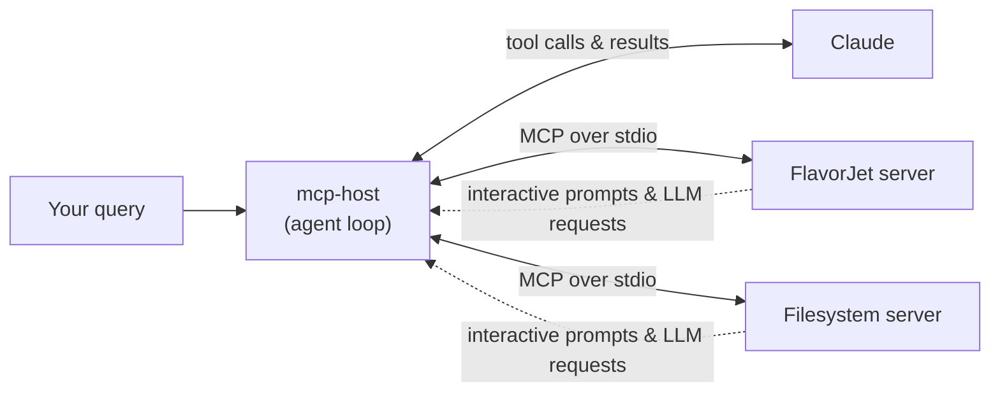

# @flavorjet/mcp-host

A minimal **MCP host** (client): a CLI agent loop that connects Claude to multiple MCP
servers at once, merges their tools into a single registry, and handles the two
request types a real host has to implement — **elicitation** (interactive forms) and
**sampling** (LLM-on-behalf-of-server). It's the consuming end of the protocol, as
opposed to [`@flavorjet/mcp-server`](../mcp-server), which is the exposing end.

## Capabilities

- **Multi-server orchestration** — connects to two independent stdio MCP servers concurrently:
  - `flavorjet` — spawns `@flavorjet/mcp-server` (`packages/mcp-server/src/stdio.ts`) via `npx tsx`, exposing FlavorJet's ordering domain (login, menu, cart, orders).
  - `fs` — spawns the official `@modelcontextprotocol/server-filesystem`, sandboxed to `packages/mcp-host/sandbox/`.
- **Namespaced tool registry** — every tool from every connected server is merged into a single registry, named `serverId:toolName` (e.g. `flavorjet:login`) so two servers can never collide on a tool name. Claude doesn't allow colons in tool names, so each name is translated to `serverId__toolName` when offered to the model, and translated back when the host dispatches the real call.
- **Agent loop** — streams Claude's reply to the terminal as it's generated; whenever Claude asks to use a tool, the host calls it on the right server, feeds the result back, and keeps going until Claude has a final answer with no more tool calls left to make.
- **Elicitation handler** — lets a server pause mid-call and ask the user for structured input, e.g. `place_order` requesting a delivery address. The host turns the server's requested fields into a short series of interactive terminal prompts, then sends the answers back.
- **Sampling handler** — lets a server ask the host's LLM to generate text on its behalf (the MCP "sampling" capability). The host forwards the request to Claude and returns the completion.
- **Shared secrets** — loads `ANTHROPIC_API_KEY` (and optional `ANTHROPIC_BASE_URL`) from the monorepo's root `.env.local`, not a package-local env file.

## Architecture



## Setup

```bash
# from repo root — npm workspaces
npm install
```

Add to the repo-root `.env.local`:

```
ANTHROPIC_API_KEY=sk-ant-...
# optional, for a proxy or alternate endpoint
ANTHROPIC_BASE_URL=
```

## Run

```bash
cd packages/mcp-host
npm start -- "Ping the flavorjet server."
```

The query is passed as a command-line argument; if you leave it out, it defaults to `"Ping the flavorjet server."`.

Example queries that exercise both servers and elicitation:

```bash
npm start -- "Log in as demo (password demo1234), add a margherita pizza to my cart, then place the order."
npm start -- "List the files in the sandbox directory."
```

Placing an order triggers an elicitation form — the host will prompt interactively on
the terminal for the delivery address and tip before the tool call completes.

## How the agent loop works

1. Connect to every server in `SERVERS`, call `listTools()` on each, and merge the results into the registry.
2. Build the Anthropic `tools` array from the merged registry (namespaced names).
3. Push the CLI query as the first `user` message.
4. Loop:
   - Stream `anthropic.messages.stream(...)`, printing text deltas live.
   - If `stop_reason !== "tool_use"`, the answer is final — break.
   - Otherwise, for every `tool_use` block: look up the owning client in the registry, call it, and collect a `tool_result` (or an `is_error` result for unknown tools / thrown exceptions).
   - Push all results back as one `user` turn and loop again.
5. Close every client connection.

## Project structure

```
packages/mcp-host/
├── src/
│   └── index.ts     Entire host: connection setup, tool registry, elicitation + sampling handlers, agent loop
├── sandbox/          Scratch directory exposed to the `fs` server (gitignored, not source)
├── package.json
└── tsconfig.json
```

## Adding another server

Add an entry to the `SERVERS` array in `src/index.ts`:

```ts
const SERVERS: ServerConfig[] = [
  { id: "flavorjet", command: "npx", args: ["tsx", flavorjetEntry] },
  {
    id: "fs",
    command: "npx",
    args: ["-y", "@modelcontextprotocol/server-filesystem", sandboxDir],
  },
  // { id: "my-server", command: "npx", args: ["tsx", "path/to/my-server.ts"] },
];
```

Every tool the new server exposes is picked up automatically — no other code changes needed.

## Notes & limitations

- Model is hardcoded to `claude-haiku-4-5` for both the agent loop and sampling responses — no model-selection flag.
- One-shot CLI: each run is a single query / single conversation. There's no REPL or persisted multi-turn session across invocations.
- Elicitation always responds `accept`; there's no decline/cancel path.
- No automated tests yet (see `packages/mcp-server` for the sibling package's test + smoke-check setup).
